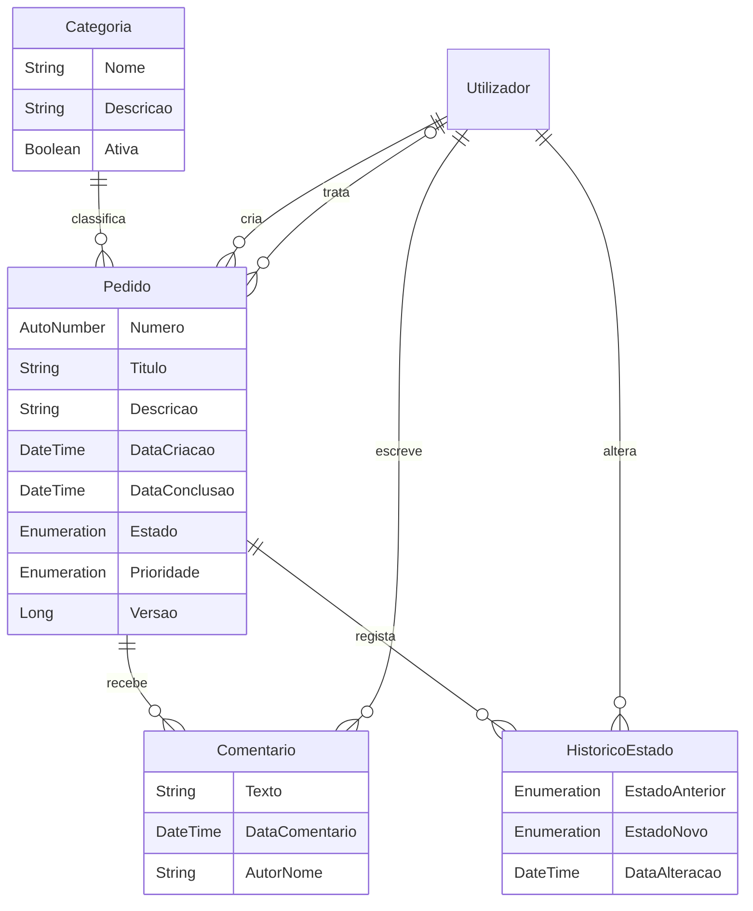

# Modelo e decisões de segurança

O módulo CampusFix usa `Administration.Account`, uma especialização de `System.User`. Não implementa uma tabela própria de palavras-passe.

`Utilizador` no diagrama representa `System.User` / `Administration.Account`. As associações Pedido_Criador e Pedido_Tecnico têm funções diferentes e são opcionais apenas para o técnico.

## Autorizações

| Recurso | Utilizador | Técnico | Administrador |
| --- | --- | --- | --- |
| Pedido | Lê os próprios | Lê disponíveis abertos e atribuídos a si | Lê todos |
| Criar/editar | Ação validada; apenas próprios abertos | Não edita conteúdo do autor | Consulta |
| Assumir/tratar/concluir | Sem acesso | Ações validadas; conclusão só do responsável | Consulta |
| Comentários/histórico | Lê os dos próprios pedidos | Lê os dos pedidos acessíveis | Lê todos |
| Comentar | Próprio pedido aberto | Pedido acessível e aberto | Pedido aberto |
| Categorias | Leitura para classificar | Leitura | Cria, edita, desativa |
| Contas e perfis | Sem administração | Sem administração | Módulo Administration |

As regras XPath em `05-seguranca-navegacao.mdl` são aplicadas nas entidades. Os botões e a navegação seguem as permissões de páginas e microflows. A segurança da aplicação está em **Production**, sem acesso anónimo e sem utilizadores demo ativos.

## Porque existem rascunhos

Os formulários não persistentes transportam apenas os campos editáveis. O cliente não tem escrita sobre Pedido, Comentario ou HistoricoEstado, nem sobre as associações de destino e a versão original dos rascunhos. O servidor resolve a identidade da sessão, recupera o pedido e verifica perfil, proprietário, estado e versão antes de guardar.

Os submicroflows `SUB_*` não recebem permissões de execução no cliente. O parâmetro Actor é um detalhe interno que permite testar as regras com identidades distintas; as ações públicas `ACT_*` obtêm-no sempre da sessão autenticada.

Os nomes de autor e técnico são cópias para apresentação. A autorização usa as associações a System.User, nunca esses nomes.

## Estados

- Criação: Novo; data de criação e criador calculados no servidor.
- Assumir: Novo para Em análise, com técnico responsável.
- Iniciar tratamento: Em análise para Em tratamento.
- Concluir: Em análise ou Em tratamento para Resolvido; exige nota de resolução e regista DataConclusao.
- Cancelar: estado aberto para Cancelado, apenas pelo autor; DataConclusao continua vazia.
- Resolvido e Cancelado são terminais.

## Limitações a conhecer

A versão do pedido impede guardar formulários desatualizados. Não substitui uma operação atómica de atribuição entre vários servidores: a atribuição concorrente em múltiplas instâncias não foi tratada como requisito desta versão escolar. Não há reabertura, anexos ou notificações por email. Não foi configurado alojamento de produção.
